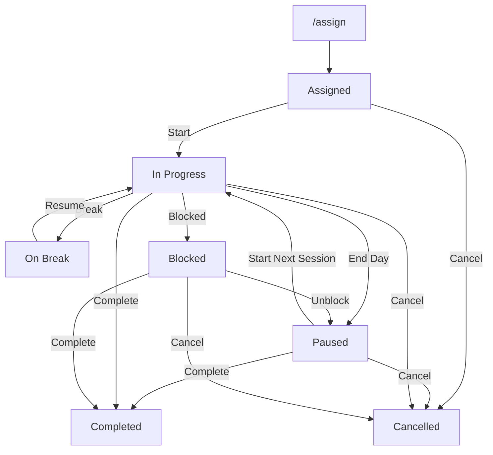

# Zen Xea — Department Task & Time Tracking Bot

<p align="center">
  <strong>A smarter way to manage work, track productivity, and coordinate teams directly through Discord.</strong>
</p>

<p align="center">
  
  
  
  
  
</p>

---

## Overview

**Zen Xea** is an internal department task and time-tracking Discord bot built with Node.js and Discord.js v14.

Designed for company environments, it provides a centralized system for assigning tasks, monitoring progress, tracking working hours, managing breaks, handling employee leave, and generating department performance reports.

The bot supports multiple departments:

- Human Resources (HR)
- Digital Marketing
- Search Engine Optimization (SEO)
- Technology
- Sales

With automated reminders, persistent task tracking, role-based permissions, and scheduled reporting, Zen Xea helps organizations maintain visibility into daily operations without relying on multiple disconnected tools.

## Table of Contents

- [Key Features](#key-features)
- [Technology Stack](#technology-stack)
- [System Architecture](#system-architecture)
- [Task Lifecycle](#task-lifecycle)
- [Slash Commands](#slash-commands)
- [Automations & Scheduling](#automations--scheduling)
- [Installation & Setup](#installation--setup)
- [Configuration](#configuration)
- [Testing](#testing)
- [Design Decisions](#design-decisions)
- [Project Structure](#project-structure)

---

## Key Features

### 1. Department-Based Task Management

- Automatically detects the department from the Discord channel category.
- Supports HR, Digital Marketing, SEO, Technology, Sales, and General.
- Automatically assigns tasks to the appropriate department.
- Organizes task cards within their respective department channels.
- Supports task reassignment while preserving historical work attribution.

### 2. Complete Task Lifecycle

Every task follows a structured lifecycle:

`assigned` → `in_progress` → `on_break` → `paused` → `blocked` → `completed` / `cancelled`

Features include:

- Task assignment and reassignment.
- Start, pause, resume, and completion actions.
- Blocked task reporting with mandatory reasons.
- Timestamped progress updates.
- End-of-day progress tracking.
- Task cancellation with historical time retention.

### 3. Precision Work & Break Tracking

Zen Xea independently tracks working time and break time using UTC Unix timestamps.

| Break Type | Allowed Duration |
|---|---:|
| Lunch Break | 75 minutes |
| Tea / Short Break | 30 minutes |
| Personal Break | 30 minutes |
| Other | 30 minutes |

Additional capabilities:

- Automatic work and break session calculations.
- Comparison of actual working time against estimated hours.
- Blocked time excluded from work and break statistics.
- Manager-authorized time adjustments through `/adjust`.
- Adjustment limit of ±720 minutes.
- Mandatory reasons and public audit logs for adjustments.

### 4. Interactive Discord Task Cards

Tasks are displayed using interactive Discord embeds with priority indicators.

| Priority | Indicator |
|---|---|
| Low | 🟢 |
| Normal | 🟡 |
| Urgent | 🔴 |

**Task Actions — Row 1**

- ▶️ Start
- ☕ Break
- 🔄 Resume
- 🌙 End Day
- ✅ Complete

**Task Actions — Row 2**

- 🚧 Blocked
- 📝 Update Note

Interactive components include buttons, select menus, and modals.

Custom interaction IDs remain static across bot restarts.

### 5. End-of-Day Workflow

Employees receive a completion confirmation when they use `/endday` or the End Day button.

**Option A — Completed**

- Marks the task as completed.
- Calculates actual time against estimated time.
- Generates a time variance summary.
- Notifies the task assigner.

**Option B — Not Completed**

- Opens a progress update modal.
- Collects the employee's end-of-day status.
- Pauses the task until the next working session.
- Publishes the progress update in the task channel.

### 6. Role-Based Access Control

Zen Xea implements permission checks at the interaction level.

**Employee permissions**
- Manage their assigned tasks.
- Start and stop work sessions.
- Record breaks and progress updates.
- Report blocked tasks.
- View their own tasks and performance reports.

**Manager permissions**

Managers have exclusive access to administrative operations, including:

- Task assignment and reassignment.
- Task editing and cancellation.
- Work and break time adjustments.
- Recurring task management.
- Holiday management.
- Server-wide performance reports.

Recognized manager roles:

`founder`, `management`, `hr manager`, `dm manager`, `seo manager`, `tech lead`, `sales manager`

Discord Administrator permissions are also recognized.

**Concurrency protection:** An employee cannot start another task while an existing task is `in_progress` or `on_break`.

### 7. Smart Reminders & Automation

All automated operations use the `Asia/Kolkata` timezone.

| Automation | Schedule |
|---|---|
| End-of-Day Reminder | 7:30 PM IST |
| Daily Performance Report | 8:00 PM IST |
| Automatic End of Day | 8:30 PM IST |
| Weekly Report | Monday, 9:00 AM IST |
| Monthly Report | 1st of the month, 9:00 AM IST |

Additional automated features:

- Break overtime notifications.
- Deadline reminders 24 hours and 2 hours before deadlines.
- Overdue task notifications.
- Automatic pausing of running tasks at the end of the day.
- DM fallback through task-channel mentions.
- Leave and holiday-aware notification suppression.
- Recurring task generation.
- Persistent reminder states across bot restarts.

### 8. Performance Reports & CSV Exports

Zen Xea generates automated productivity reports at three intervals:

- **Daily:** Current day's performance.
- **Weekly:** Previous week's performance.
- **Monthly:** Previous month's performance.

Reports are automatically routed to department-specific report channels when available.

Employees and managers can also generate reports on demand.

Available functionality:

- `/report` — Performance summary using Discord embeds.
- `/export` — Downloadable CSV reports.
- User-based filtering.
- Department-based filtering.
- Period-based reporting.
- Historical session attribution.
- Accurate reporting through period-boundary session clipping.

---

## Technology Stack

| Component | Technology | Purpose |
|---|---|---|
| Runtime | Node.js 20+ | JavaScript execution environment |
| Language | JavaScript (ES2022+) | CommonJS application architecture |
| Discord API | discord.js v14 | Commands, buttons, modals and interactions |
| Database | better-sqlite3 | Persistent SQLite storage |
| Date & Time | Luxon | Timezone-aware date calculations |
| Scheduler | node-cron | Scheduled automation |
| Configuration | dotenv | Environment variable management |
| Testing | Node.js assert | Unit and integration testing |

### Database Architecture

The application uses SQLite with Write-Ahead Logging (WAL) mode.

Database responsibilities include:

- Task records and lifecycle states.
- Work and break sessions.
- Employee progress updates.
- Leave and holiday records.
- Recurring task configurations.
- Time adjustment history.
- Scheduler execution metadata.
- Reminder deduplication flags.

**Database file:** `taskbot.db`

**Gateway Intents:** Only `GatewayIntentBits.Guilds` is required. No privileged Gateway Intents are used.

---

## System Architecture

The application follows a modular architecture that separates business logic, persistence, scheduling, reporting, and Discord interaction handling.

| Module | Responsibility |
|---|---|
| `index.js` | Discord client, startup and interaction routing |
| `config.js` | Centralized application configuration |
| `db.js` | SQLite schema, queries and database operations |
| `logic.js` | Task transitions, permissions, embeds and time calculations |
| `reports.js` | Report aggregation, period clipping and CSV generation |
| `scheduler.js` | Automated reminders, recurring tasks and scheduled jobs |
| `deploy-commands.js` | Discord slash command registration |
| `test.js` | Acceptance and integration tests |

### Task Lifecycle



---

## Slash Commands

Zen Xea provides 19 registered application commands with employee and manager permission controls.

### Employee Commands

| Command | Description |
|---|---|
| `/start [task_id]` | Start the work timer. |
| `/break [reason] [task_id]` | Start a break session. |
| `/resume [task_id]` | End break and resume work. |
| `/endday [task_id]` | Begin the end-of-day status workflow. |
| `/complete [task_id]` | Complete an assigned task. |
| `/blocked reason [task_id]` | Report a blocked task. |
| `/unblock [task_id]` | Move a blocked task to paused status. |
| `/update note [task_id]` | Submit a timestamped progress update. |
| `/tasks [member]` | View available tasks. |
| `/leave add/cancel/list` | Manage employee leave records. |
| `/report period [member] [dept]` | Generate a performance report. |
| `/export period [member] [dept]` | Export performance data as CSV. |

### Manager Commands

| Command | Description |
|---|---|
| `/assign member title estimate_hours [priority] [description] [deadline]` | Assign a new task. |
| `/reassign task_id member` | Reassign a task to another employee. |
| `/edit task_id [fields...]` | Modify task details. |
| `/cancel task_id reason` | Cancel an active task. |
| `/adjust task_id minutes kind reason` | Adjust logged work or break time. |
| `/recurring add/list/remove` | Manage recurring task templates. |
| `/holiday add/remove/list` | Manage company holidays. |
| `/shift set/list/remove` | Configure employee shift schedules. |

*Permission checks are enforced by the bot. Administrative commands are restricted to authorized managers and server administrators.*

---

## Automations & Scheduling

The scheduler uses a one-minute ticker to execute automated operations.

### Daily Workflow

| Time (IST) | Operation |
|---|---|
| 7:30 PM | Notify employees with active tasks. |
| 8:00 PM | Generate daily department reports. |
| 8:30 PM | Automatically pause running tasks and publish channel logs. |

### Weekly & Monthly Workflow

| Schedule | Operation |
|---|---|
| Monday, 9:00 AM | Generate previous week's reports. |
| 1st of each month, 9:00 AM | Generate previous month's reports. |

### Reliability & Restart Safety

Reminder execution states are persisted in SQLite rather than relying exclusively on in-memory timers.

Tracked states include:

- `reminded_24h`
- `reminded_2h`
- `reminded_overdue`
- `break_reminded`
- Scheduler date keys in the `meta` table.

This prevents duplicate notifications when scheduler jobs execute repeatedly or the bot restarts.

---

## Installation & Setup

### Prerequisites

- Node.js 20.0.0 or higher.
- npm 9.0.0 or higher.
- A Discord application created through the [Discord Developer Portal](https://discord.com/developers/applications).

### 1. Clone the Repository

```bash
git clone <YOUR_REPOSITORY_URL>
cd "Discord Bot Zen Xea"
```

### 2. Install Dependencies

```bash
npm install
```

### 3. Create a Discord Application

1. Open the [Discord Developer Portal](https://discord.com/developers/applications).
2. Create a new application.
3. Navigate to the **Bot** section.
4. Generate your bot token.
5. Keep all privileged Gateway Intents disabled.

### 4. Configure Bot Permissions

Under **OAuth2 → URL Generator**, select:

**Scopes**
- `bot`
- `applications.commands`

**Bot Permissions**
- Send Messages
- Send Messages in Threads
- Embed Links
- Attach Files
- Read Message History
- Use External Emojis

Generate the invitation URL and add the bot to your Discord server.

### 5. Configure Environment Variables

Create a `.env` file using the provided template.

```bash
cp .env.example .env
```

Add your Discord credentials:

```env
DISCORD_TOKEN=your_bot_token_here
CLIENT_ID=your_client_id_here
GUILD_ID=your_test_guild_id_here
```

`GUILD_ID` is optional and can be used for immediate command registration during development.

**Security:** Never commit your `.env` file or expose your Discord bot token publicly.

### 6. Deploy Slash Commands

```bash
npm run deploy
```

This registers the application's slash commands.

- With `GUILD_ID`: Commands are registered to the specified server.
- Without `GUILD_ID`: Commands are registered globally.

### 7. Start the Bot

```bash
npm start
```

Zen Xea is now ready to operate in your Discord server.

---

## Configuration

All operational settings are centralized in `config.js`.

### Timezone

```javascript
const TIMEZONE = 'Asia/Kolkata';
```

### Manager Roles

```javascript
const MANAGER_ROLES = [
  'founder',
  'management',
  'hr manager',
  'dm manager',
  'seo manager',
  'tech lead',
  'sales manager',
];
```

### Break Configuration

```javascript
const BREAK_TYPES = [
  'Lunch break',
  'Tea / short break',
  'Personal break',
  'Other',
];

const BREAK_LIMITS_MIN = {
  'Lunch break': 75,
  'Tea / short break': 30,
  'Personal break': 30,
  'Other': 30,
  'default': 30,
};
```

### Scheduler Configuration

```javascript
const EOD_REMINDER_TIME = '19:30';
const AUTO_END_DAY_TIME = '20:30';
const DAILY_REPORT_TIME = '20:00';

const WORKING_DAYS = [1, 2, 3, 4, 5, 6];

const DEADLINE_REMINDERS_HOURS = [24, 2];
```

All times are interpreted in `Asia/Kolkata`.

---

## Testing

Zen Xea includes a dedicated acceptance test suite using Node.js's built-in `assert` module and an in-memory SQLite database.

Run the test suite:

```bash
npm test
```

### Verified Test Cases

| # | Test | Validation |
|---|---|---|
| 1 | Full Task Lifecycle | Correct work and break time calculations across task transitions. |
| 2 | Concurrent Task Prevention | Prevents employees from starting multiple active tasks. |
| 3 | Permission Isolation | Restricts employee and manager operations based on roles. |
| 4 | Blocked Time Exclusion | Excludes blocked duration from work and break statistics. |
| 5 | Time Adjustments | Validates signed adjustments within the ±720-minute limit. |
| 6 | Reassignment Attribution | Preserves historical session ownership. |
| 7 | Cancelled Tasks | Retains worked time while excluding cancelled tasks from completion statistics. |
| 8 | Reminder Deduplication | Prevents duplicate break and deadline notifications. |
| 9 | End-of-Day & Exclusions | Validates automatic pausing and leave/holiday suppression. |
| 10 | Reporting & CSV | Validates period clipping and CSV output structure. |

---

## Design Decisions

### 1. Category-Based Department Detection

Department identification uses:

```javascript
interaction.channel.parent.name
```

Tasks inherit the parent category name. Channels without a category are assigned to `General`.

### 2. Department Report Routing

Scheduled reports are delivered to a text channel within the department category whose name contains `report` (case-insensitive).

Examples:

- `#tech-reports`
- `#sales-reports`

If no matching channel exists, the report falls back to the original task channel.

### 3. Ghost-Ping Prevention

Routine channel messages use:

```javascript
allowedMentions: { parse: [] }
```

Explicit mentions are permitted only for:

- Blocked task notifications.
- Task completion notifications.
- DM fallback notifications.

### 4. Restart-Safe Scheduling

Reminder flags and scheduler execution states are stored in SQLite, ensuring automated jobs can recover their execution state after a restart.

### 5. Accurate Reporting Through Session Clipping

Sessions crossing reporting boundaries are clipped to the requested period.

For example, a session running from Sunday at 11:45 PM to Monday at 12:30 AM is split appropriately between the two reporting periods.

This ensures daily, weekly, and monthly reports contain only the time attributable to their respective periods.

---

## Project Structure

```text
Discord Bot Zen Xea/
│
├── .env.example
├── .gitignore
│
├── config.js
├── db.js
├── logic.js
├── reports.js
├── scheduler.js
│
├── deploy-commands.js
├── index.js
│
├── test.js
├── package.json
├── package-lock.json
│
└── README.md
```

---

<p align="center">
  <strong>Zen Xea</strong>
  <br />
  <em>Bringing structure, accountability, and visibility to everyday work.</em>
</p>
